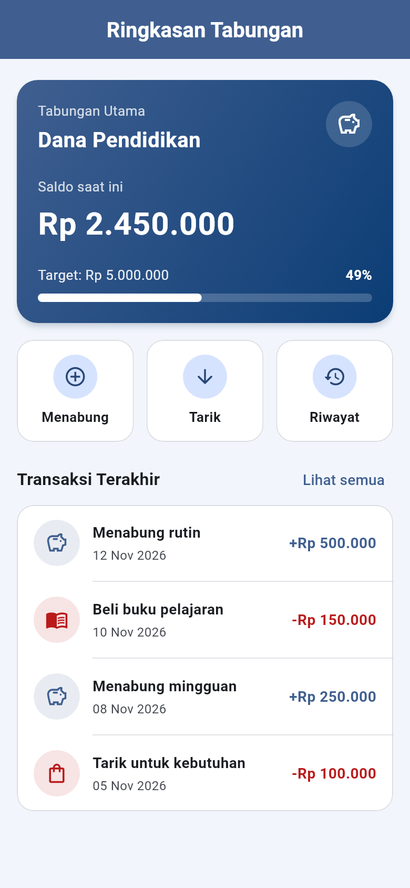

# TabungKu — Layout Ringkasan Tabungan

Aplikasi Flutter sederhana untuk **Tugas Minggu 3: Menyusun Layout dengan Widget Dasar Flutter** pada mata kuliah TI505 Pemrograman Mobile.

Halaman utama menampilkan layar **Ringkasan Tabungan** yang berisi kartu saldo, tiga tombol kategori, dan daftar transaksi. Seluruh layout dibangun memakai widget dasar Flutter **tanpa paket pihak ketiga** (termasuk tanpa GetX).

## Identitas

| Item | Keterangan |
|---|---|
| Nama | Dafa Rafi Nur Wansyah |
| NIM | 20240801157 |
| Mata kuliah | TI505 Pemrograman Mobile (3 SKS) |
| Pertemuan | 3 |
| Tugas | Tugas Minggu 3: Menyusun Layout dengan Widget Dasar Flutter |

## Tangkapan Layar

| Ponsel potret (390 × 844) | Tablet (800 × 1280) |
|---|---|
|  |  |

Kedua tangkapan layar berada di folder [`docs/`](docs/). Layout sudah diuji bebas *overflow* pada kedua ukuran tersebut.

## Fitur Layout

- `Scaffold` dengan `AppBar` berjudul **"Ringkasan Tabungan"**.
- `Card` berisi nama tabungan (**Dana Pendidikan**), saldo, target, dan progress bar.
  Progress bar dibuat manual dengan `Container` dan properti `alignment`.
- `Row` berisi tiga tombol kategori: **Menabung**, **Tarik**, dan **Riwayat**.
  Ketiganya memakai `Expanded` agar lebarnya terbagi rata.
- Daftar **4 transaksi** statis, masing-masing menampilkan judul, tanggal, dan nominal
  (biru untuk pemasukan, merah untuk pengeluaran).
- Jarak dan posisi diatur dengan `Padding`, `SizedBox`, `Container`,
  `mainAxisAlignment`, `crossAxisAlignment`, dan `alignment`.
- Responsif melalui `LayoutBuilder`:
  - Ponsel (< 600 px): padding horizontal 16 px.
  - Tablet (≥ 600 px): padding horizontal 32 px.
  - Lebar konten dibatasi maksimal 720 px dan ditengahkan agar nyaman dibaca di tablet.
  - `SingleChildScrollView` mencegah overflow bila tinggi konten melebihi layar.
- Kode disusun rapi dan mudah dibaca tanpa komentar tambahan.

## Struktur Hierarki Widget

```text
TabungKuApp (MaterialApp)
└── RingkasanPage (Scaffold)
    ├── AppBar
    │   └── Text("Ringkasan Tabungan")
    └── SafeArea
        └── LayoutBuilder
            └── SingleChildScrollView
                └── Center
                    └── ConstrainedBox (maxWidth: 720)
                        └── Padding
                            └── Column
                                ├── _KartuSaldo (Card > Container > Column)
                                │   ├── Row (nama tabungan + ikon)
                                │   ├── Text (saldo)
                                │   ├── Row (target + persentase)
                                │   └── progress bar (Container + alignment)
                                ├── SizedBox
                                ├── _BarisAksi (Row)
                                │   ├── Expanded > _TombolAksi (Menabung)
                                │   ├── Expanded > _TombolAksi (Tarik)
                                │   └── Expanded > _TombolAksi (Riwayat)
                                ├── SizedBox
                                ├── _JudulBagian (Row)
                                ├── SizedBox
                                └── _DaftarTransaksi (Card > Column)
                                    └── _ItemTransaksi (Row) × 4
```

## Widget yang Digunakan

`Scaffold`, `AppBar`, `SafeArea`, `LayoutBuilder`, `SingleChildScrollView`,
`Center`, `ConstrainedBox`, `Padding`, `Column`, `Row`, `Expanded`, `SizedBox`,
`Card`, `Container`, `Text`, `Icon`, `InkWell`, `TextButton`, `Divider`, dan
`SnackBar`. Semuanya berasal dari Flutter SDK.

## Cara Menjalankan

1. Pastikan Flutter SDK sudah terpasang.
   ```bash
   flutter --version
   ```
2. Ambil dependensi proyek.
   ```bash
   flutter pub get
   ```
3. Jalankan aplikasi pada perangkat/emulator yang aktif.
   ```bash
   flutter run
   ```
   Untuk memilih perangkat tertentu:
   ```bash
   flutter devices
   flutter run -d <device-id>
   ```

## Pengujian

```bash
flutter analyze
flutter test
```

`test/widget_test.dart` memeriksa dua hal:

1. Seluruh komponen utama halaman tampil (judul, saldo, target, tombol, transaksi).
2. Tidak ada overflow pada layar ponsel **390 × 844** dan tablet **800 × 1280**.

Status: `flutter test` lulus 3/3 dan `flutter build web --release` berhasil.

## Struktur Proyek

```text
tabungku_layout/
├── lib/
│   └── main.dart                    # TabungKuApp + RingkasanPage
├── test/
│   └── widget_test.dart             # Uji komponen & bebas overflow
├── docs/
│   ├── screenshot-ponsel.png        # 390 × 844
│   ├── screenshot-tablet.png        # 800 × 1280
│   └── tugas-minggu-3-tabungku-layout.md
├── android/ ios/ web/ ...           # Platform bawaan Flutter
├── pubspec.yaml
└── README.md
```

## Catatan

- Data transaksi masih statis (*hard-coded*) sesuai ketentuan tugas.
- Tidak ada dependensi paket pihak ketiga pada `pubspec.yaml`.
- Tombol kategori hanya menampilkan `SnackBar` sebagai umpan balik; fitur formulir
  dan pengelolaan data akan dikerjakan pada pertemuan berikutnya.
