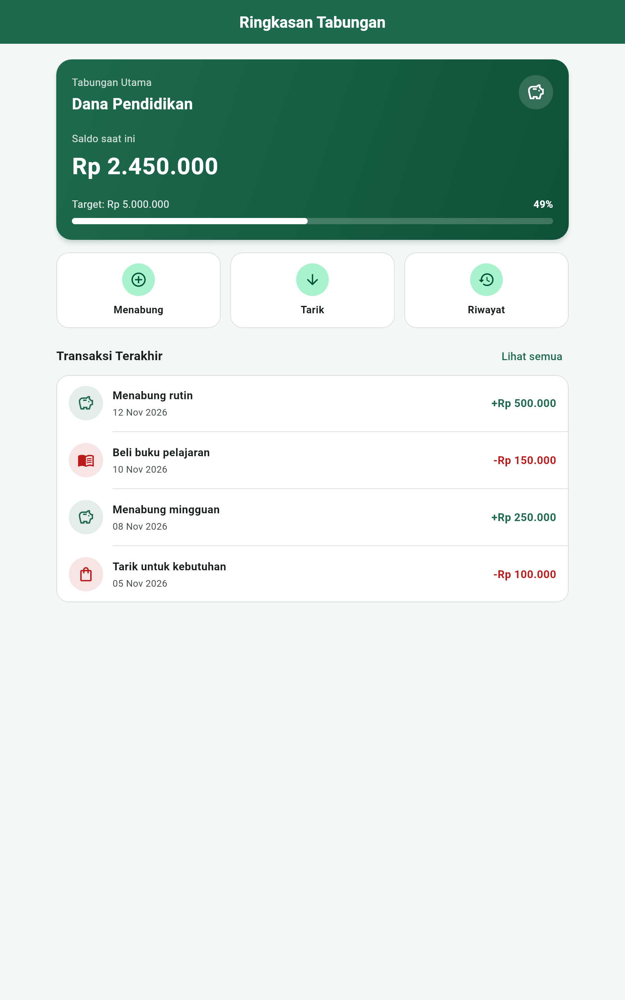

# TabungKu — Tugas Minggu 3

Aplikasi Flutter sederhana untuk tugas **Menyusun Layout dengan Widget Dasar Flutter**.
Halaman utama menampilkan **Ringkasan Tabungan** yang terdiri dari kartu saldo,
tiga tombol kategori, dan daftar transaksi statis.

## Identitas

| Item | Keterangan |
|---|---|
| Nama | Dafa Rafi Nur Wansyah |
| NIM | 20240801157 |
| Mata kuliah | TI505 Pemrograman Mobile (3 SKS) |
| Tugas | Tugas Minggu 3: Menyusun Layout dengan Widget Dasar Flutter |

## Tampilan

| Ponsel (390 × 844) | Tablet (800 × 1280) |
|---|---|
|  |  |

## Fitur Layout

- `Scaffold` + `AppBar` berjudul **"Ringkasan Tabungan"**.
- `Card` berisi nama tabungan (**Dana Pendidikan**), saldo, target, dan progress
  bar yang disusun dengan `Column`, `Row`, `Container`, serta `alignment`.
- `Row` berisi tiga tombol kategori: **Menabung**, **Tarik**, dan **Riwayat**.
- Daftar minimal tiga transaksi (judul, tanggal, nominal) dengan data statis.
- Jarak dan posisi diatur memakai `Padding`, `SizedBox`, `Container`,
  `mainAxisAlignment`, dan `crossAxisAlignment`.
- Responsif: lebar konten dibatasi `720` pada tablet dan padding menyesuaikan
  lebar layar melalui `LayoutBuilder`; isi halaman dapat di-scroll sehingga
  tidak overflow pada ponsel potret maupun tablet.
- Hanya menggunakan widget dasar Flutter. **Tanpa paket pihak ketiga** (termasuk
  GetX).

## Cara Menjalankan

1. Pastikan Flutter SDK sudah terpasang.
   ```bash
   flutter --version
   ```
2. Ambil dependensi proyek.
   ```bash
   flutter pub get
   ```
3. Jalankan aplikasi pada perangkat/emulator yang aktif.
   ```bash
   flutter run
   ```
   Untuk memilih perangkat tertentu:
   ```bash
   flutter devices
   flutter run -d <device-id>
   ```
4. (Opsional) Jalankan pengujian layout.
   ```bash
   flutter analyze
   flutter test
   ```

## Struktur Proyek

```text
tabungku_layout/
├── lib/
│   └── main.dart              # Seluruh kode halaman RingkasanPage
├── test/
│   └── widget_test.dart       # Uji tampilan & bebas overflow
├── docs/
│   ├── screenshot-ponsel.png  # Tangkapan layar 390 x 844
│   ├── screenshot-tablet.png  # Tangkapan layar 800 x 1280
│   └── tugas-minggu-3-tabungku-layout.md
└── pubspec.yaml
```
